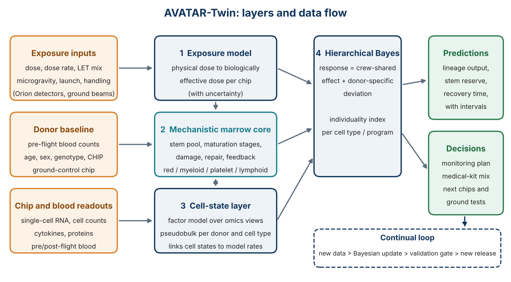
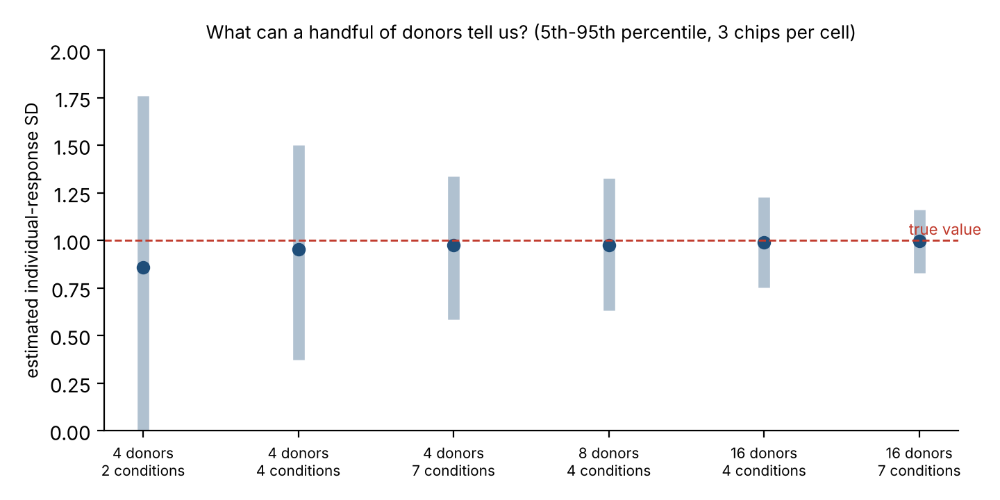
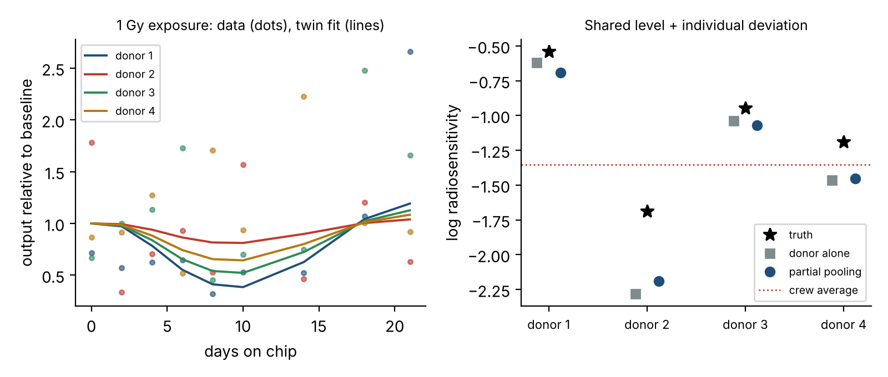

## 1. Summary

NASA's AVATAR chips are small bone marrow models built from the cells of the crew who flew them. They are a rare chance to ask a personal question: how will *this* astronaut's blood and immune system respond to deep space? A single flight with a handful of donors cannot answer that on its own. A model has to carry what each flight teaches forward.

This paper proposes **AVATAR-Twin**, a digital twin built in four layers: an exposure model, a mechanistic model of blood-cell production, a single-cell state layer that fuses the multi-omic data, and a hierarchical Bayesian layer that splits every response into a **crew-shared part** and a **donor-specific part**. New data updates the model through a Bayesian update step, and every new version has to pass a validation gate before it is released. The twin also reports which next experiment would teach it the most.

The design uses only what is publicly known about AVATAR and what the wider literature has shown. I did not have access to AVATAR data. The small simulations here are synthetic and are labelled that way. Code is on GitHub (Section 10).

| Challenge goal | What AVATAR-Twin does | Section |
|---|---|---|
| Predict blood and immune cell change under stressors such as radiation | Mechanistic marrow core with dose-response, damage, repair and recovery, plus an exposure model | 4 |
| Combine environmental, physiological and multi-omics data | One shared model that links dosimetry, blood counts and single-cell data | 4 |
| Separate individual effects from crew-wide effects | Hierarchical model with an individuality index per cell type | 5 |
| Keep improving as new data arrives | Sequential Bayesian updating, validation gate, experiment recommendation | 6 |

## 2. What is known, and what is not

**The AVATAR chips.** AVATAR (A Virtual Astronaut Tissue Analog Response) uses organ chips to study how deep-space stressors, including radiation and microgravity, affect human tissue [1]. The Artemis II chips hold bone marrow tissue made from blood-forming stem and progenitor cells donated by crew members, grown alongside blood vessel cells and supporting cells [2]. The chips flew in an automated payload inside Orion for about ten days around the Moon [2]. After return, Emulate began single-cell RNA sequencing of each crew member's chip, to be compared with ground control chips and with pre- and post-flight blood samples [1].

**Why marrow.** Bone marrow is among the organs most sensitive to radiation and it makes every red cell, white cell and platelet [2]. The bone marrow chip has already been shown to reproduce marrow toxicity after clinically relevant chemotherapy and ionizing radiation, and recovery afterwards, and it captured patient-specific disease [3].

**What spaceflight does to blood.** Three lines of evidence matter for the twin.

- *Red cells.* In 14 astronauts on six-month ISS missions, red blood cell destruction ran 54 percent above normal, and was still elevated a year after landing [4][5]. The marrow has to make up the difference, so marrow reserve decides how long a crew member can keep up.
- *Immune and molecular change.* The NASA Twins Study followed one astronaut for about a year and found many gene expression changes that were not seen in his twin on the ground [6][7]. The Inspiration4 crew (four people) were studied in the Space Omics and Medical Atlas, a resource built by more than 100 investigators in 25 countries [8]. Single-cell data from that crew showed a "spaceflight signature" and both conserved and distinct immune disruptions across missions [9].
- *Clonal expansion.* Somatic mutations linked to clonal hematopoiesis were found in all 14 shuttle-era astronauts tested [10], and twin astronauts showed clones decades earlier than usual and larger shifts in clone size than age-matched controls [11]. In mice carrying human blood stem cells, simulated solar and cosmic radiation raised concern about leukemia risk [12]. So the twin must carry each person's clonal status as an input, not as an afterthought.

**What is not known.** The public pages give no chip counts, no replicates per donor, and no radiation sensor details for the chips [2]. Ten days around the Moon is a short, low-dose exposure compared with a Mars mission. In flight, microgravity, radiation, launch loads and hardware handling all act at once, so a flight-only comparison cannot say which stressor did what. And a chip has no spleen, no circulating red cell clearance and no full immune system. Section 7 shows how the twin deals with each of these.

## 3. Design principles

1. **Mechanism first, learning second.** Models that encode how marrow works can be fitted with few donors. Large learned models need far more data than four people can supply. A 2025 benchmark found that five single-cell foundation models and two other deep models did not beat deliberately simple linear baselines at predicting perturbation effects [13]. So AVATAR-Twin starts from a mechanistic core and has to prove any added complexity on held-out donors.
2. **Stress-specific and donor-specific parameters kept apart.** Myelosuppression models should ideally keep drug-specific and system-specific parameters separate [14]. Here the stressor sets one group of parameters and the donor sets another.
3. **Every number carries uncertainty.** A decision about one astronaut needs an interval, not a point.
4. **Credibility is part of the design.** The National Academies treat verification, validation and uncertainty quantification as a continuing task that adapts as models and data change [15], and the ASME V&V 40 standard ties required evidence to model risk and context of use [16].

## 4. Architecture

{width=86%}

**Layer 1: Exposure model.** It turns raw environment data into a biologically relevant dose for each chip. Inputs are dose rate and particle mix measured by the Orion detectors, microgravity, and handling. Orion measurements on Artemis I already showed about a fourfold spread in dose rate between locations during proton-belt passes [17], so location matters and the model keeps dose uncertainty as a distribution. Galactic cosmic rays are mostly protons (about 85 percent) with a small heavy-ion share that does outsized damage [18], so the model treats low-LET and high-LET dose as separate inputs. Ground exposures give the dose-response anchor.

**Layer 2: Mechanistic marrow core.** This is a semi-mechanistic model in the Friberg tradition: a proliferating progenitor pool, several maturation stages and a circulating output, with feedback that holds output near baseline [14]. I extend it to four lineages (red, myeloid, platelet and lymphoid) that share a common stem and progenitor pool, and add three things the chemotherapy models leave out: radiation damage with repair and misrepair, a clonal state that can drift, and a microgravity term acting on differentiation. The core gives mechanistic predictions of lineage output, stem reserve and recovery time, and it gives the model its shape when data are thin.

**Layer 3: Single-cell state layer.** Single-cell data are summed to pseudobulk per donor, chip and cell type before testing, because cells from one donor are not independent replicates and methods that ignore this produce false discoveries [19]. A Bayesian factor model across data views (RNA, cytokines, proteins, blood counts) finds axes of variation shared across views and axes specific to one view [20][21]. The factor scores then feed the rates in Layer 2, for example an apoptosis program raising the cell-death rate and an oxidative phosphorylation program shifting stem cell activation. This is the link between omics and mechanism.

**Layer 4: Hierarchical Bayesian layer.** This is where individual and shared effects are separated (Section 5).

*Table 1. Data streams and what each is used for.*

| Stream | Examples | Role in the twin |
|---|---|---|
| Environmental | Dose rate, particle mix, shielding location, temperature, microgravity | Layer 1 inputs; covariates for dose-response |
| Physiological | Pre/post-flight blood counts, hemolysis markers, clonal status | Donor baseline; human translation targets |
| Multi-omics | Single-cell RNA, cytokines, proteins, epigenome | Layer 3 states; calibrate Layer 2 rates |
| Priors from outside | NASA OSDR [22], SOMA [8], Twins Study [6], chip radiation data [3] | Prior distributions; independent validation |

## 5. Separating individual effects from crew-wide effects

For donor *d*, condition *s* (ground control, flight, ground radiation level) and cell type or program *c*, each measured quantity is modelled as

> ***y*(d,s,c) = *a*(d,c) + *β*(s,c) + *b*(d,s,c) + *ε*(d,s,c)**,  with *b*(d,s,c) drawn from Normal(0, *σ*c²)

where *a* is the donor's own baseline, *β* is the effect shared across the crew, *b* is the donor-specific deviation in how that person responds, and *ε* is measurement noise. In the mechanistic core the same idea applies to parameters: log *θ*d = *μ* + *u*d, with *u*d drawn from Normal(0, *τ*²), for example for radiosensitivity. This is partial pooling: each donor's estimate is pulled toward the crew average by an amount the data decide.

The framework follows Bayesian multistudy factor analysis, which identifies shared and study-specific signal [21]. Here each donor plays the role of a "study".

**Individuality index.** For each cell type or program I report *I*c = *σ*c² / (*σ*c² + *β*c²), where *β*c is the shared flight-versus-ground effect. Near 0, the crew behaves as one group and the average is a good guide for everyone. Near 1, the average says little about any one person and personal monitoring matters. The index comes with a credible interval.

**How the model avoids mistaking baseline differences for response differences.** Each donor has ground control chips, so the donor's own baseline *a* is estimated separately and removed. What is left is the *response* difference.

**What four donors can and cannot tell us.** This is the honest limit, so I measured it. I simulated experiments with a known individual-response spread and asked how well the spread can be recovered under different designs (Figure 1, code in the repository). With four donors and only flight versus ground (two conditions), the estimate is nearly uninformative: the 5th to 95th percentile ran from 0.00 to 1.76 against a true value of 1.0. Adding more exposure conditions per donor narrowed it clearly (0.37 to 1.50 with four conditions, 0.59 to 1.34 with seven). Adding donors helped more (0.75 to 1.23 with 16 donors and four conditions).

{width=72%}

Two practical conclusions follow. First, a **ground dose ladder** (the same donors' chips exposed to several radiation levels and qualities on the ground) is the cheapest way to make the flight data interpretable. Second, outside cohorts supply priors for how large individual spread usually is, which is where Inspiration4 and the Twins Study come in [6][8][9].

I also built a small demonstration of the partial pooling step (Figure 2). Four synthetic donors with different radiosensitivity are measured with noise. When data are noisy relative to the true individual spread, partial pooling lowered the error compared with fitting each donor alone (average error 0.159 against 0.172 over 100 simulated missions, better in 67 of 100 runs). When data are clean, it makes no difference, so it is not a free gain. It protects against over-reading noise when samples are few.

{width=78%}

## 6. Continuous improvement

**Sequential Bayesian updating.** Treat the model forecast as the prior and each new batch of data as the likelihood. Bayesian data assimilation does this for individual patients in chemotherapy dosing and handles variability between occasions and folds in monitoring data efficiently [23]. For a twin shared across missions, a two-stage hierarchical scheme updates the individual parameters and the population parameters separately, so sites can learn from each other while sharing only model-level summaries instead of raw personal data [24]. This matters because a crew of four is easy to re-identify.

**Release gate.** The live model is frozen. A candidate model is retrained on new data, scored on held-out donors and chips against the current release and against a linear baseline, and only promoted if it passes pre-set criteria. Each release records its data, code version, priors and test results, in line with the National Academies call for continual validation as models and data change [15].

**Experiment recommendation.** Because the twin has posterior uncertainty, it can rank candidate experiments by expected information gain: which extra dose level, which time point, how many replicate chips, or which new donor would shrink the interval on the individuality index the most. The twin does not just improve as data arrive; it asks for the data it needs.

**Drift checks.** Every new mission's chips are first predicted before the data are used. A large miss triggers a review, not a silent refit.

## 7. Validation and credibility

I propose a three-tier plan tied to a stated context of use.

**Context of use.** To give uncertainty-aware predictions of how an individual's marrow lineages respond to defined radiation and microgravity exposure, so that planners can decide monitoring and medical-kit contents. It is not a diagnostic and it does not replace clinical care. Under V&V 40 the evidence required scales with model risk [16]. I would argue this is a decision-support role of moderate risk, so the evidence should be substantial but need not match a device that acts directly on a patient.

*Table 2. Validation tiers.*

| Tier | Question | Test |
|---|---|---|
| A. Chip level | Can the twin predict a chip it has not seen? | Leave-one-donor-out and leave-one-chip-out; coverage of 90% intervals; compared with a linear baseline |
| B. Dose response | Does the model respond correctly to dose and quality? | Ground dose ladder on matched chips (gamma, proton, heavy ions); compare predicted and observed curves |
| C. Human translation | Does chip behaviour map to the astronaut's own blood? | Pre/post-flight counts and, where available, single-cell blood; outside checks against Inspiration4, Twins Study and ISS hemolysis data [4][6][8] |

**Translation from chip to human** is the largest gap. The chip lacks systemic red cell destruction, so it cannot show space anemia directly. The twin handles this by treating hemolysis load as an external input from human data [4]: the chip tells us how much *production capacity* a donor's marrow has under stress, and the human data tell us how much capacity is being *demanded*. The ratio is the quantity of interest. It is a hypothesis to be tested, not a result.

**Failure rules fixed in advance.** If interval coverage on held-out donors falls below the target, if the model does not beat the linear baseline, or if an individuality estimate flips sign between releases, the model is not promoted and the case is reported.

## 8. Outputs that support decisions

For each crew member and exposure scenario, the twin would report, with intervals:

- Predicted trajectories of red, myeloid, platelet and lymphoid output and the recovery time after a solar particle event.
- Stem pool reserve, and how it changes over a long mission as hemolysis load rises.
- A clonal-expansion risk flag where the donor carries relevant clones.
- The individuality index for each cell type, which tells planners where the crew average is safe to use and where it is not.

These support concrete choices: how often to check blood counts for each person, which countermeasure classes to stock, and which crew member to prioritize for follow-up. This matches NASA's stated aim of tailoring medical supplies to each astronaut [2]. Radiation planning still sits inside NASA's career limit of 600 mSv and the 250 mSv limit per solar particle event [25]. The twin adds a personal marrow view on top of those limits and does not replace them.

## 9. Evidence from around the world

The twin draws on work from many countries, which is a strength for priors and independent checks.

*Table 3. Global evidence base.*

| Source | What it adds |
|---|---|
| NASA, USA: AVATAR, Twins Study, OSDR, Artemis I Orion dosimetry [1][6][17][22] | Chip design, multi-omic baseline, open data, radiation field |
| Wyss Institute and Emulate, USA [3] | Bone marrow chip toxicity and radiation response |
| Canadian Space Agency and Ottawa (MARROW) [4] | Direct measures of red cell destruction in 14 astronauts |
| Inspiration4 / SOMA, 25 countries [8][9] | Single-cell multi-ome of a civilian crew; >10-fold more public human space omics |
| DLR, Germany, with NASA and ESA [17] | Orion radiation measurements with phantoms |
| China (SJ-10, Tianzhou, Tiangong) [26] | Stem cell proliferation under spaceflight; organ-chip flights |
| France (CNES, Institut Pasteur), Switzerland (UZH, Airbus), Singapore (NUS MBI) [27] | Organoid and tissue work on the ISS and in parabolic flight |
| Australia (ANSTO) [28] | Expert analysis of Artemis II radiation measurements |
| Pharmacometrics and statistics, Europe and USA [14][19][20][21][23][24] | Myelosuppression models, factor models, data assimilation |

## 10. Plan, needs and limits

**Plan (12 months from award).**

- *Months 0 to 3:* fix the context of use; harmonize public priors (OSDR, SOMA, Twins); build Layers 1 and 2 and calibrate on published chip data [3].
- *Months 3 to 6:* build Layers 3 and 4; run the design analysis on the real replicate structure; propose the ground dose ladder.
- *Months 6 to 9:* fit to the Artemis II chips; leave-one-donor-out tests; compare with the linear baseline.
- *Months 9 to 12:* chip-to-blood translation tests; first release candidate; model card and update protocol.

**What I would need from NASA and partners.** Chip-level data with donor IDs, chip batch and hardware metadata, dosimetry by payload location, ground control chip data, and pre/post-flight blood data, under whatever privacy terms NASA sets.

**Limits.** AVATAR has a small number of donors and a short, low-dose exposure. Flight stressors are confounded. Chips do not have a whole-body environment. Single-cell data describe cell state, not function. The individuality index will have wide intervals until more donors and ground conditions exist. The synthetic demonstrations in this paper show how the method behaves, not what AVATAR will find. All claims about astronaut outcomes are hypotheses until the validation tiers are passed.

**Code.** The design simulation and the partial-pooling demonstration are on GitHub, with figures, slides and the video script. Link: https://github.com/nanthafourbrothers-coder/bps-avatar-digital-twin

## References

1. NASA. AVATAR investigation page. <https://science.nasa.gov/biological-physical/investigations/avatar/>
2. NASA. Avatars for Astronaut Health to Fly on NASA's Artemis II. <https://science.nasa.gov/uncategorized/avatars-for-astronaut-health-nasa-artemis-ii>
3. Chou DB, et al. On-chip recapitulation of clinical bone marrow toxicities and patient-specific pathophysiology. *Nat Biomed Eng* 2020;4:394-406. doi:10.1038/s41551-019-0495-z
4. Trudel G, et al. Hemolysis contributes to anemia during long-duration space flight. *Nat Med* 2022;28:59-62. doi:10.1038/s41591-021-01637-7
5. The Ottawa Hospital. Being in space destroys more red blood cells (2022). <https://ohri.ca/en/newsroom/being-space-destroys-more-red-blood-cells>
6. Garrett-Bakelman FE, et al. The NASA Twins Study: a multidimensional analysis of a year-long human spaceflight. *Science* 2019;364:eaau8650. doi:10.1126/science.aau8650
7. NIH Director's Blog. NASA Twins Study reveals health effects of space flight. <https://directorsblog.nih.gov/tag/astronauts/>
8. Overbey EG, et al. The Space Omics and Medical Atlas (SOMA) and international astronaut biobank. *Nature* 2024. doi:10.1038/s41586-024-07639-y
9. Kim JK, et al. Single-cell multi-ome and immune profiles of the Inspiration4 crew. *Nat Commun* 2024;15:4954. doi:10.1038/s41467-024-49211-2
10. Retrospective analysis of somatic mutations and clonal hematopoiesis in astronauts. *Commun Biol* 2022;5:828. doi:10.1038/s42003-022-03777-z
11. Clonal hematopoiesis in twin astronauts over four years. <https://pmc.ncbi.nlm.nih.gov/articles/PMC9398182>
12. In vitro and in vivo assessment of direct effects of simulated solar and galactic cosmic radiation on human hematopoietic stem/progenitor cells. *Leukemia* 2016. doi:10.1038/leu.2016.344
13. Ahlmann-Eltze C, Huber W, Anders S. Deep-learning-based gene perturbation effect prediction does not yet outperform simple linear baselines. *Nat Methods* 2025;22:1657-1661. doi:10.1038/s41592-025-02772-6
14. Friberg LE, et al. Model of chemotherapy-induced myelosuppression with parameter consistency across drugs. *J Clin Oncol* 2002.
15. National Academies. Foundational Research Gaps and Future Directions for Digital Twins. 2023. doi:10.17226/26894
16. ASME V&V 40-2018. Assessing credibility of computational modeling through verification and validation: application to medical devices. Overview: <https://www.pubmed.gov/30973403/>
17. Orion radiation measurements on Artemis I (*Nature* 2024); DLR summary: <https://www.dlr.de/en/latest/news/2024/orion-spacecraft-radiation-protection-tested-initial-findings-from-artemis-i-moon-mission>
18. Low doses of oxygen ion irradiation cause acute damage to hematopoietic cells in mice. *PLoS ONE* 2016. <https://doaj.org/article/34aa8b67d4f84776861858387cd87a80>
19. Squair JW, et al. Confronting false discoveries in single-cell differential expression. *Nat Commun* 2021;12:5692.
20. Argelaguet R, et al. Multi-Omics Factor Analysis. *Mol Syst Biol* 2018. doi:10.15252/msb.20178124; and MOFA+, *Genome Biol* 2020;21:111.
21. De Vito R, Bellio R, Trippa L, Parmigiani G. Bayesian multistudy factor analysis for high-throughput biological data. *Ann Appl Stat* 2021;15:1723-1741. doi:10.1214/21-AOAS1456
22. NASA Open Science Data Repository: open science for life in space. *Nucleic Acids Res* 2025;53:D1697-D1710. doi:10.1093/nar/gkae1116
23. Maier C, Hartung N, de Wiljes J, Kloft C, Huisinga W. Bayesian data assimilation to support informed decision-making in individualised chemotherapy. arXiv:1909.09451
24. Sequential hierarchical Bayesian framework for continued learning across patients (Huisinga group). arXiv:2106.03752
25. NASA Office of the Chief Health and Medical Officer. Radiation protection technical brief (NASA-STD-3001). <https://www.nasa.gov/wp-content/uploads/2023/03/radiation-protection-technical-brief-ochmo.pdf>
26. Spaceflight/microgravity inhibits the proliferation of hematopoietic stem cells (SJ-10 satellite, Tianzhou-1). <https://pmc.ncbi.nlm.nih.gov/articles/PMC6463920>; China brain-chip flight to Tiangong. <https://www.scmp.com/news/china/science/article/3318590/how-does-space-affect-mind-china-sends-mini-brain-tiangong-find-out>
27. Institut Pasteur / CNES cerebral organoids on the ISS. <https://www.pasteur.fr/en/home/research-journal/news/studying-aging-cerebral-organoids-back-space-flight>; Airbus and University of Zurich organoids on the ISS. <https://airbus.com/en/newsroom/press-releases/2021-08-university-of-zurich-and-airbus-grow-miniature-human-tissue-on-the>; NUS Mechanobiology Institute, Zero-G Wells. <https://www.mbi.nus.edu.sg/?p=37033>
28. ANSTO. Artemis II and the invisible hazard on the way to the Moon. <https://www.ansto.gov.au/news/artemis-ii-and-invisible-hazard-on-way-to-moon-part-1>
